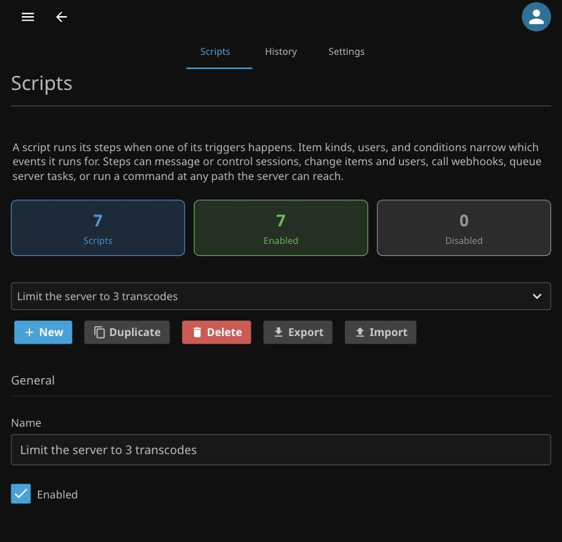
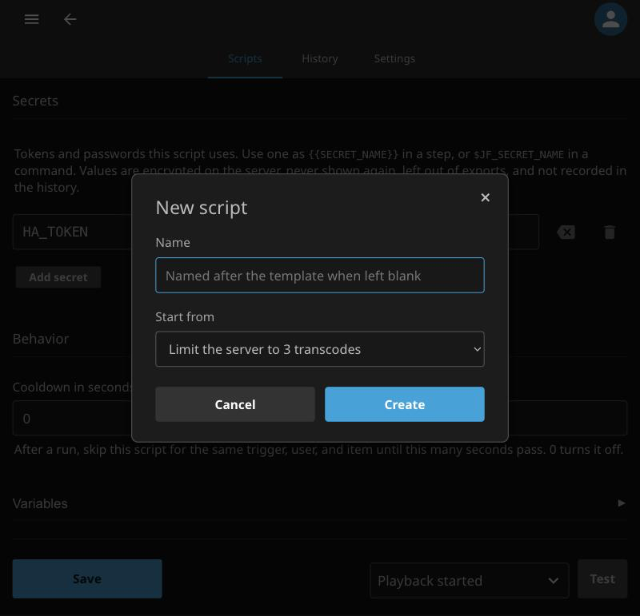
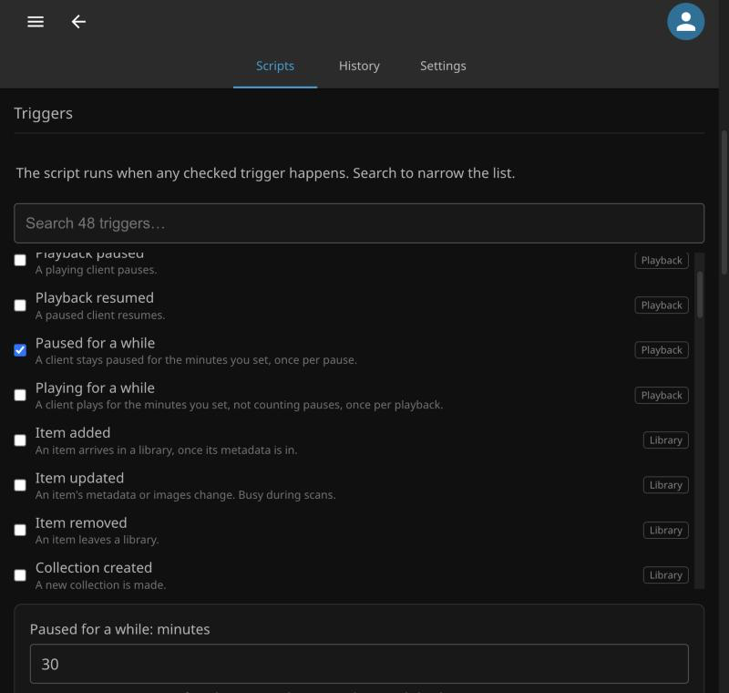
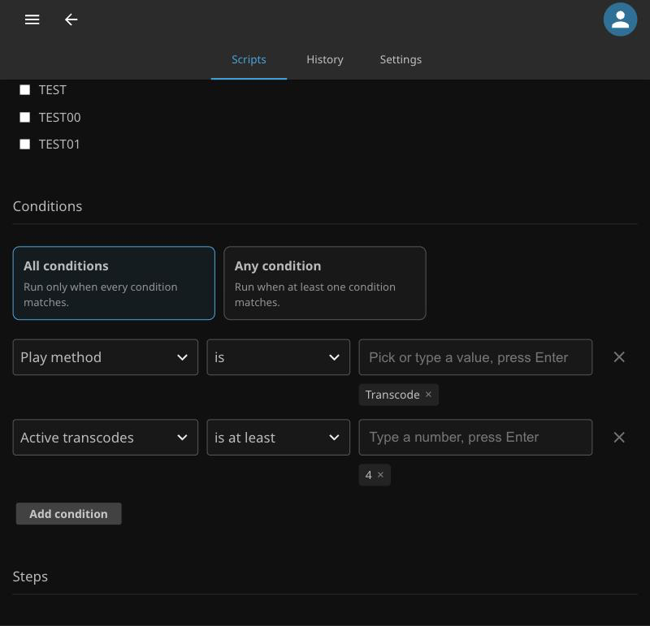
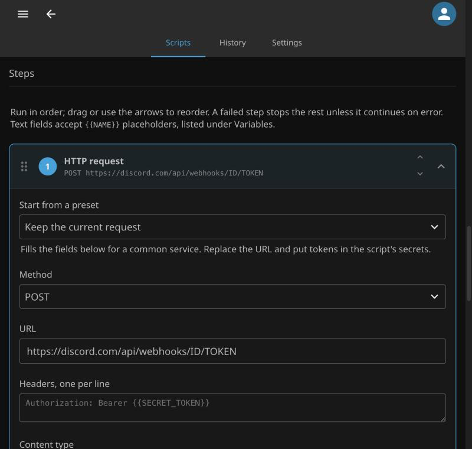
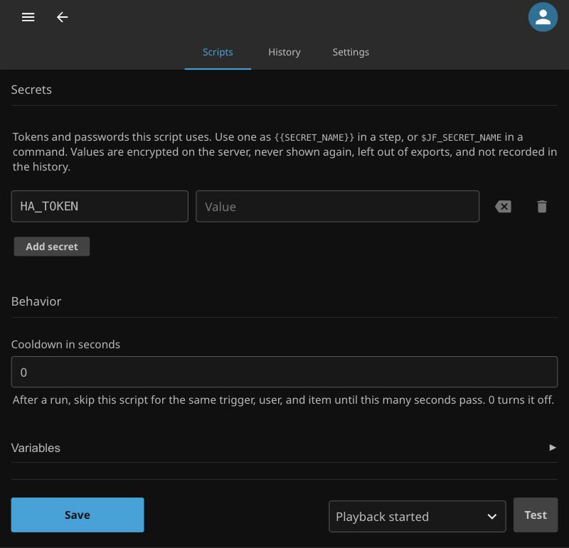
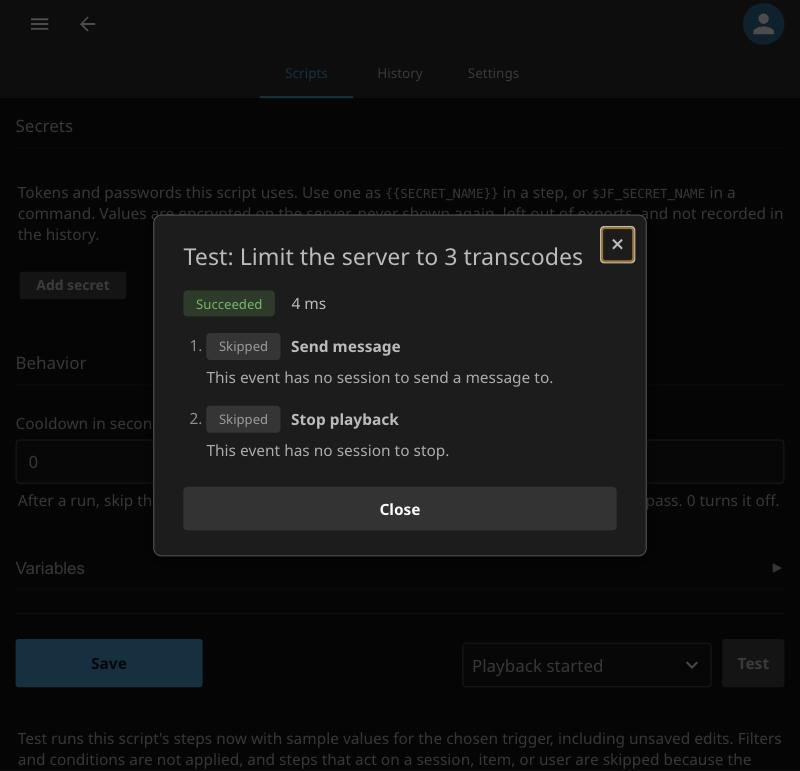
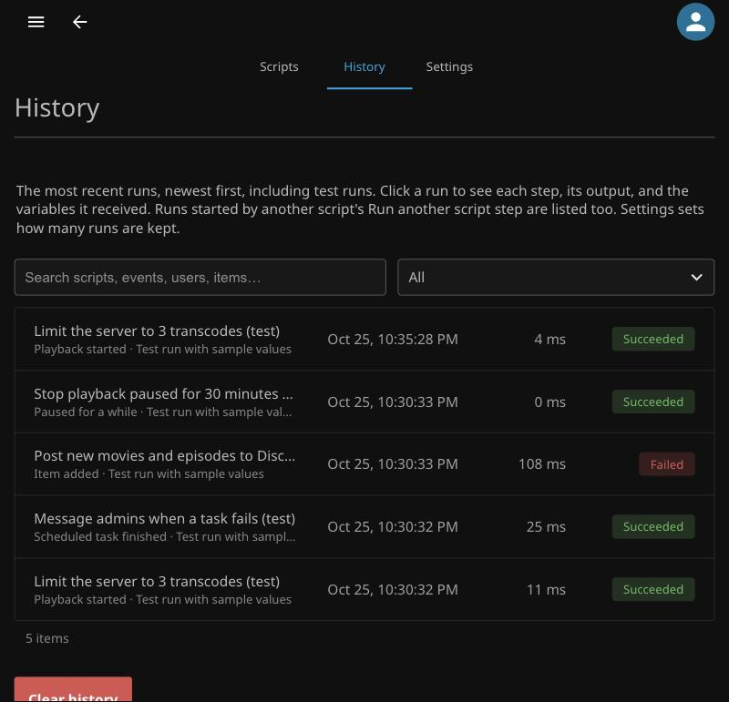
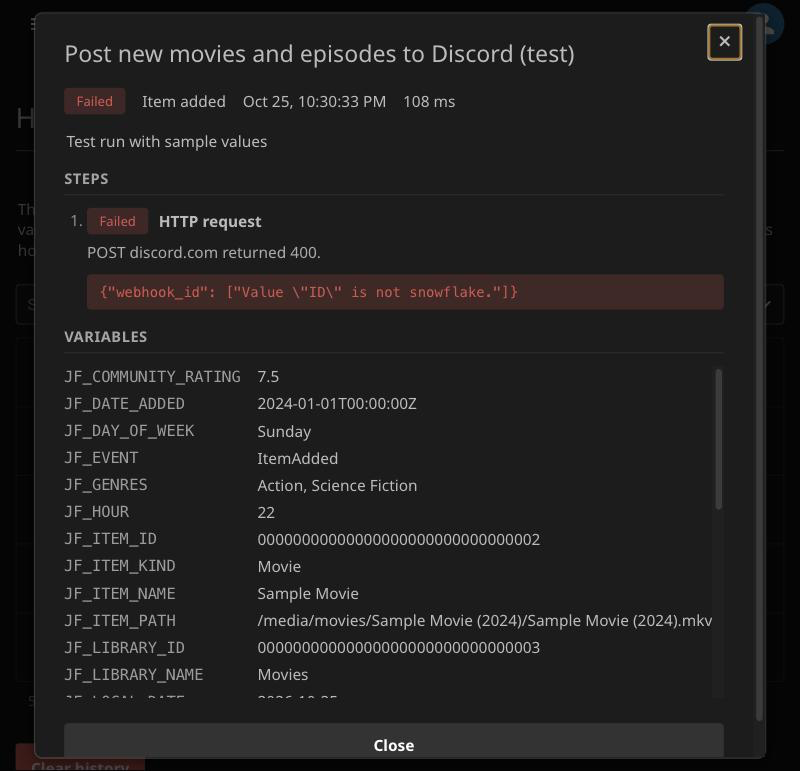
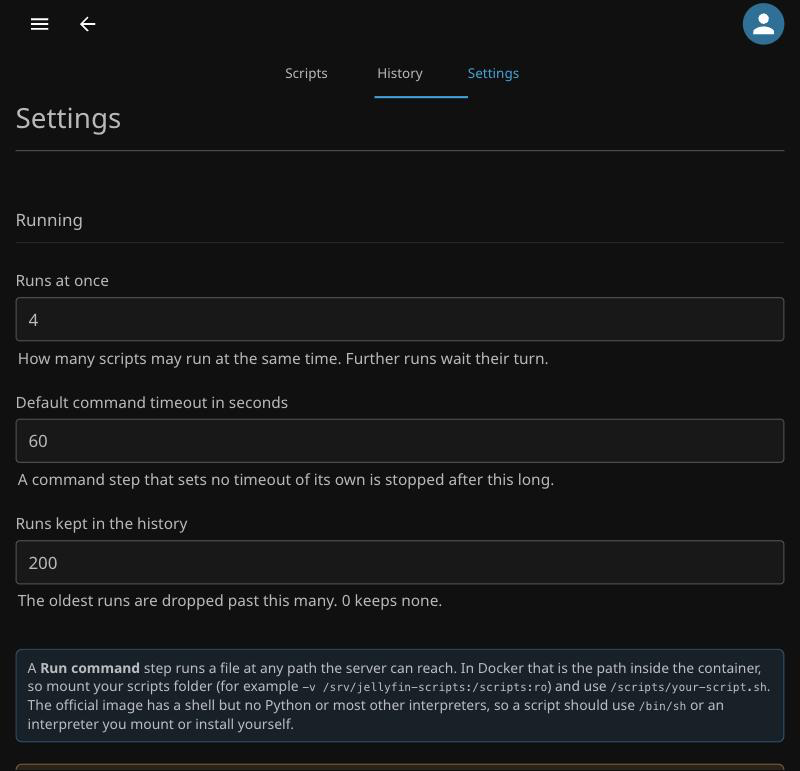

# Writing Scripts

Each script has **triggers**, optional **item kinds**, **users**, and **conditions** that narrow which events it runs for, and a list of **steps** it performs in order. Scripts are managed on **Dashboard → Plugins → Scripts**.



**New script** starts from a blank script or a template, such as stopping playback paused for 30 minutes, limiting the server to 3 transcodes, asking "Still watching?" after 3 hours, posting new items to Discord, or scanning every library nightly. **Duplicate** copies the open script. Changes are kept until you **Save**, and leaving the page with unsaved changes asks first.



## Triggers

A script runs on any of the triggers it lists. The list is grouped and searchable.



### Playback

| Trigger | Runs when |
|---|---|
| Playback started | A client starts playing something. This is after the client has started loading, so it cannot change what plays. |
| Playback stopped | A client stops playing. `PLAYED_TO_COMPLETION` says whether it reached the end. |
| Playback paused, Playback resumed | A playing client pauses or resumes. Fires once per change. |
| Paused for a while | A client stays paused for the minutes you set. Fires once per pause. |
| Playing for a while | A client plays for the minutes you set, not counting pauses. Fires once per playback. |

Every playback trigger carries the user, session, and item, plus `ACTIVE_STREAMS` and `ACTIVE_TRANSCODES` counted across the server.

### Library

| Trigger | Runs when |
|---|---|
| Item added | An item arrives in a library. It waits up to a minute for the item's metadata, so names and provider IDs are filled. Placeholder items, such as missing episodes, are skipped. |
| Item updated | An item's metadata or images change. `UPDATE_REASON` says why. Busy during scans, so pair it with item kinds or conditions. |
| Item removed | An item leaves a library. By then it has left its library, so `LIBRARY_ID` and `LIBRARY_NAME` are empty and a **Library** condition never matches. |
| Collection created | A new collection is made. |
| Added to collection, Removed from collection | An item is added to or removed from an existing collection. Items a collection is created with count as **Collection created** only. |
| Subtitle download failed, Lyrics download failed | A provider fails to download subtitles or lyrics. `PROVIDER` and `ERROR_MESSAGE` say which and why. |
| Metadata refresh started, Metadata refresh finished | A metadata refresh of an item starts or finishes. |
| Library settings changed | A library's settings are saved. |

### Live TV

| Trigger | Runs when |
|---|---|
| Recording scheduled, Recording cancelled | A single recording is scheduled or cancelled. |
| Series recording scheduled, Series recording cancelled | A series recording is scheduled or cancelled. |

### Activity

| Trigger | Runs when |
|---|---|
| Marked played, Marked unplayed | A user marks an item played or unplayed. |
| Favorite changed | A user adds or removes a favorite. `IS_FAVORITE` says which. |

### Sessions

| Trigger | Runs when |
|---|---|
| Session started, Session ended | A client session starts or ends. |
| Signed in | A user signs in. |
| Client connected | A client opens its live connection, so it can receive messages and commands. Use this, not **Signed in**, to message a client as it arrives. |
| Device settings changed | A device's settings, such as its custom name, change. |
| Sign in failed | A sign in fails for an existing user. Jellyfin reports no event for a username that doesn't exist. |

### Accounts

| Trigger | Runs when |
|---|---|
| User created, User deleted | A user account is created or deleted. |
| User edited | A user's name or profile is edited. Jellyfin reports no event for permission or policy changes. |
| User locked out | A user is locked out after too many failed sign ins. |
| Password changed | A user's password changes. |

### System

| Trigger | Runs when |
|---|---|
| Server started | The server finishes starting. |
| Restart needed | The server needs a restart to apply a change, such as a plugin install. |
| Scheduled task started, Scheduled task finished | A scheduled task starts, or finishes whatever its outcome. |
| Activity logged | Any entry is written to the activity log, by Jellyfin or another plugin. Entries this plugin writes are ignored, so a script cannot set itself off. |
| Server settings changed | The server's settings are saved. `SETTINGS_KEY` names the section, such as `encoding` or `network`. Jellyfin also saves its settings while starting, so expect a run then. |
| Network changed | The server's network interfaces or addresses change. |
| Plugin installing, Plugin installed, Plugin updated, Plugin uninstalled, Plugin install cancelled | A plugin's installation starts, finishes, is updated, removed, or cancelled. |

### Schedule

**On a schedule** runs the script without an event:

* **Interval**: every so many minutes. The first run comes one interval after the server first sees the schedule, not the moment it is saved. An interval that passed while the server was off runs once when it starts.
* **Daily**: at a time of day, on the days of the week you pick, or every day when none are picked.
* **Monthly**: at a time on a day of the month. A day past the end of a short month runs on its last day.

Times are the server's local time. A daily or monthly run is still made if the server was busy for up to two minutes past the time, and never twice for the same time. One missed while the server was off is skipped, not made up.

## Item kinds

Choose the kinds of item the script runs for, such as Movie, Episode, Audio, or Collection. Every kind the server knows is offered, and nothing is assumed: leave the list empty to run for every kind.

Item kinds only filter triggers that carry an item. Others ignore them.

!!! warning
    A library scan adds people, genres, studios, and folders as items too. A script on **Item added** or **Item updated** with no item kinds runs for all of them.

## Users

Choose the users the script runs for, or leave the list empty to run for everyone. On playback, the script runs when any of the session's users is listed. A failed sign in counts only when the typed name belongs to a listed user.

Users only filter triggers that carry a user. Others ignore them. For anything finer, such as matching a name pattern, use a **User** condition.

## Conditions

Each condition compares one event value with one or more values, using **is**, **is not**, **contains**, **does not contain**, **starts with**, or **matches regex**. Numeric fields, such as **Year** or **Active transcodes**, also offer **is at least** and **is at most**. Text comparisons ignore case. A positive operator matches when any value matches, and a negative one matches when none do. Choose whether the script runs when **all** conditions match or when **any** does.



| Group | Fields |
|---|---|
| Who | User (ID or name; on playback, any of the session's users), Is administrator, Username attempted |
| Where | Client, Client version, Device name, Device ID, Remote address, Is local network |
| What | Library, Item name, Series name, Item path, Genre, Tag, Studio, Parental rating, Year, Video height, Community rating, Collection |
| Playback | Play method, Progress percent, Played to completion, Transcode reasons, Video codec, Audio codec, Active streams, Active transcodes, Is played, Is favorite |
| When | Hour (0 to 23), Day of week |
| System | Scheduled task, Task status, Task category, Plugin name, Provider, Update reason, Activity type, Activity severity |

Genre, Tag, and Studio match when any of the item's values does. A field the trigger does not supply, or a value this event happens to lack, never matches, for **is not** and **does not contain** too. For example, **Series name is not** does not match a movie, which has no series. The editor warns when a condition's field is missing from some of the selected triggers.

**Cooldown** skips the script for the same trigger, user, and item until the given number of seconds have passed since its last run, so a script on both start and stop still sees the stop. It keeps pause and resume from running a script over and over.

## Steps

Steps run in order. Drag a step, or use its arrows, to reorder it, and open it to edit.



| Group | Step | Does | Needs |
|---|---|---|---|
| Run | Run command | Runs a program or script at any path the server can reach, or a name on the server's PATH such as `curl`. | |
| | HTTP request | Sends a GET, POST, PUT, PATCH, or DELETE with your headers and body. | |
| | Run another script | Runs another script's steps with this event, skipping its triggers and filters. Up to 3 levels deep. | |
| | Wait | Pauses before the next step. | |
| Sessions | Send message | Shows a message on the event's session, all of the event's user's sessions, every session, or every administrator's session. | |
| | Pause playback | Pauses the event's session. | A session |
| | Stop playback | Stops the event's session, optionally after a message. | A session |
| Items | Mark played, Mark unplayed | Marks the event's item for the event's user. | A user and an item |
| | Set favorite | Adds or removes the event's item as the user's favorite. | A user and an item |
| | Add tag, Remove tag | Adds or removes a tag on the event's item. Placeholders are filled. | An item |
| | Add to collection, Remove from collection | Adds the event's item to a collection, or removes it. | An item |
| | Refresh metadata | Queues a standard or full refresh of the event's item. | An item |
| Users | Disable or enable user | Disables or enables the event's user. Administrators are never disabled. | A user |
| | Sign user out | Signs the event's user out of every device. Administrators are never signed out. | A user |
| Server | Scan libraries | Queues a scan of every library. | |
| | Run scheduled task | Queues a scheduled task. A task finishing can't queue itself, since that would repeat forever. | |
| | Write to activity log | Adds an entry to the server's activity log. | |
| | Append to file | Appends a line to a file, creating the file if its folder exists. | |

A step that needs something the event lacks is skipped. A failed step stops the rest unless it is set to **Continue on error**. A run with a failed step is also written to the activity log.

### HTTP request

**Start from a preset** fills the request for a generic JSON webhook, Discord, Slack, ntfy, Gotify, or a Home Assistant service call. Replace the URL, and put tokens in the script's [secrets](#secrets). **Retries** tries again, up to 5 times and waiting longer each time, after no answer, a 5xx, or a 429.

### Run command

Use **Check path** to confirm the server can see the file and that it is executable. The server runs it as the account Jellyfin runs under, in the folder that holds the script unless you set a working folder. It is stopped after its timeout, which defaults to the value on the Settings tab. A script may start a background process and exit; the step reports the script's own exit code as soon as it finishes.

**Run directly** passes each line of **Arguments** as exactly one argument, with placeholders filled, so a value containing spaces or quotes never splits into more.

**Through the shell** makes the command one line for `/bin/sh -c`, which allows pipes and redirects. Placeholders are not filled in a shell line, so event values such as item or device names can never inject shell syntax. Read them from the environment instead:

```sh
/scripts/log.sh "$JF_USER_NAME" "$JF_ITEM_NAME" >> /scripts/plays.log
```

!!! warning "Windows"
    On Windows a shell line runs through `cmd /c`, which expands `%JF_...%` variables *before* it parses the line, so an event value such as a typed username can carry cmd syntax. Read event values inside a script file instead of in the shell line. A `.bat` or `.cmd` file is refused when one of its filled arguments contains `% " & | < > ^`, since cmd does not honour the quoting other programs get.

!!! info "Docker"
    The path is the path inside the container. Mount your scripts, for example `-v /srv/jellyfin-scripts:/scripts:ro`, and use `/scripts/notify.sh`. The official image has a shell but no Python or most other interpreters, so write scripts for `/bin/sh` or mount the interpreter you need.

## Secrets

Keep tokens and passwords in the script's **Secrets** rather than in its steps. Use one as `{{SECRET_NAME}}` in a step, or `$JF_SECRET_NAME` in a command. Values are encrypted on the server, never sent back to the browser, left out of exports, and left out of the variables the history records. A command that prints a secret still puts it in its captured output, so don't echo them.



## Variables

A command receives every variable the trigger supplies as an environment variable with a `JF_` prefix, such as `$JF_ITEM_NAME`, plus `$JF_EVENT_JSON` holding all of them as one JSON object. A value the event lacks is set to an empty string, so a script under `set -u` can still test it.

In a step's text fields, write a variable as `{{ITEM_NAME}}`. Use `{{ITEM_NAME:json}}` inside a JSON string, and `{{ITEM_NAME:url}}` inside a URL. The **Variables** section of the editor lists the ones the selected triggers supply, and clicking one copies it.

| Group | Variables |
|---|---|
| Every event | `EVENT`, `TIMESTAMP`, `LOCAL_DATE`, `LOCAL_TIME`, `HOUR`, `DAY_OF_WEEK`, `SCRIPT_NAME`, `SERVER_NAME`, `SERVER_ID`, `SERVER_VERSION`, `EVENT_JSON` |
| User | `USER_ID`, `USER_NAME`, `IS_ADMIN` |
| Session | `SESSION_ID`, `CLIENT`, `CLIENT_VERSION`, `DEVICE_ID`, `DEVICE_NAME`, `REMOTE_ADDRESS`, `IS_LOCAL` |
| Item | `ITEM_ID`, `ITEM_NAME`, `ITEM_KIND`, `ITEM_PATH`, `LIBRARY_ID`, `LIBRARY_NAME`, `YEAR`, `RUNTIME_SECONDS`, `SERIES_NAME`, `SEASON_NUMBER`, `EPISODE_NUMBER`, `ALBUM`, `ARTIST`, `GENRES`, `TAGS`, `STUDIOS`, `OFFICIAL_RATING`, `COMMUNITY_RATING`, `VIDEO_WIDTH`, `VIDEO_HEIGHT`, `DATE_ADDED`, `PROVIDER_IMDB`, `PROVIDER_TMDB`, `PROVIDER_TVDB` |
| Playback | `PLAY_SESSION_ID`, `PLAY_METHOD` (on stop, the method seen while playing), `POSITION_SECONDS`, `PROGRESS_PERCENT`, `IS_PAUSED`, `VIDEO_CODEC`, `AUDIO_CODEC`, `TRANSCODE_REASONS`, `ACTIVE_STREAMS`, `ACTIVE_TRANSCODES`; on stop `PLAYED_TO_COMPLETION`, paused for a while `PAUSED_SECONDS`, playing for a while `PLAYING_SECONDS` |
| Played and favorites | `IS_PLAYED`, `IS_FAVORITE`, `PLAY_COUNT` |
| Collections | `COLLECTION_ID`, `COLLECTION_NAME` |
| Item updated | `UPDATE_REASON` |
| Download failed | `PROVIDER`, `ERROR_MESSAGE` |
| Live TV | `TIMER_ID`, `PROGRAM_ID` |
| Library settings | `LIBRARY_PATH` |
| Device settings | `DEVICE_ID`, `DEVICE_NAME` |
| Server settings | `SETTINGS_KEY` |
| Activity logged | `ACTIVITY_NAME`, `ACTIVITY_TYPE`, `ACTIVITY_OVERVIEW`, `ACTIVITY_SEVERITY`, `USER_ID` |
| Sign in failed | `USERNAME_ATTEMPTED`, `USER_ID` |
| Scheduled task | `TASK_NAME`, `TASK_KEY`, `TASK_CATEGORY`, and when it finishes `TASK_STATUS`, `TASK_ERROR`, `TASK_DURATION_SECONDS` |
| Plugins | `PLUGIN_ID`, `PLUGIN_NAME`, `PLUGIN_VERSION` |

## Export and import

**Export** on the Scripts tab saves every script, including unsaved edits, to a JSON file. Secret values are left out. **Import** reads one back, adding its scripts or replacing ones with the same ID. Imported scripts start **disabled** and unsaved, so review each one's steps and fill in its secrets before enabling it and saving, since a command runs on your server.

Users are stored by ID, so on another server a script's users show as unknown until you pick them again.

## Testing

**Test** runs the open script's steps right away, including unsaved edits and its secrets, with sample values for the chosen trigger. Item kinds and conditions are not applied, and steps that act on a session, user, or item are skipped, because the sample has none.



## History

Every run, tests included, is listed on the **History** tab. Search it, or filter it to failed runs, tests, or one script.



Open a run to see each step's result, the captured output, and the variables it received.



## Settings

The **Settings** tab sets how many scripts run at once, the default command timeout, and how many runs the history keeps.


